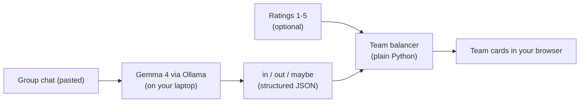

<div align="center">

# ⚽ Touch Grass FC

### Paste the group chat. Get fair teams. Go play outside.

A football kickabout organiser powered by an **open-weight AI model that runs entirely on your own laptop**. No cloud, no API key, no Wi-Fi needed once it's set up.


*Built for the Hacktoberfest Open-Source AI Challenge, Week 1: "Touch Grass".*

</div>

<!-- TODO: add your DEV post link here after publishing, e.g. "Read the write-up: [link]" -->

---

## 📸 See it in action

<!-- TODO: save your screenshots in a docs/ folder and keep these names, or change the paths. -->


<!-- TODO (optional): add a GIF, e.g.  -->

---

## 🧩 The problem

Anyone who has organised a kickabout knows the pre-match chaos:

> "I'm in" · "maybe, depends on my shift" · "count me in, bringing my cousin" · "sorry, out this week" · "update: I'm in after all!"

Before the game, someone has to scroll through dozens of messages, count heads, work out whether "maybe" means "yes", and then split everyone into **fair** teams, which is the part nobody wants to do, because it means admitting who the strong players are.

**Touch Grass FC does that admin for you**, so the screen is the shortest part of your football day.

## ✨ What it does

- 📋 **Reads the chat exactly as it is.** Paste the messy group chat, with no cleaning or formatting needed.
- 🧠 **Sorts everyone** into **in**, **out** or **maybe** using a local AI model.
- 👥 **Spots guests.** "Bringing my cousin Brian" becomes a separate player.
- 🔢 **Any number of teams.** A slider lets you pick 2 to 6 teams.
- ⚖️ **Balanced by skill.** Give players a rating from 1 to 5 and the teams come out fair. Ratings are optional.
- 🔒 **Private by design.** Your friends' names and messages never leave your computer.
- 📴 **Works offline** after the one-time model download.

## 🔧 How it works



The job is split in two on purpose:

| Role | Who does it | Why |
|---|---|---|
| **The secretary** (`rsvp.py`) | The local AI model | Understanding messy human language is what AI is good at. |
| **The coach** (`teams.py`) | Plain Python | Fair, predictable maths is better done by code than by a small model. |

---

## 🚀 Quick start

### What you need

- **Python 3.9 or newer**
- **[Ollama](https://ollama.com)** installed and running
- About **4 GB of free RAM** for the model (it runs on the CPU, so no GPU is needed)
- Internet **only once**, to download the model

### 1. Get the code

```bash
git clone https://github.com/USERNAME/touch-grass-fc.git
cd touch-grass-fc
```

<!-- TODO: replace USERNAME with your GitHub username -->

### 2. Download the open-weight model (one time)

```bash
ollama pull gemma4:e2b-it-qat
```

This downloads about 4 GB. After that, no internet is needed.

### 3. Install the Python libraries

```bash
python -m pip install -r requirements.txt
```

### 4. Run the app

```bash
python -m streamlit run app.py
```

Your browser opens the app at `http://localhost:8501`.

> **Windows tip:** use `python -m streamlit run app.py` rather than plain `streamlit run app.py`. The plain command often isn't on the PATH and PowerShell says it can't find it.

> **Heads up:** the very first "Make teams" press is slow (around two minutes on a CPU-only laptop with 8 GB of RAM), because the model has to load from disk into memory. It then stays loaded for 30 minutes, so later runs are much faster.

---

## 🎮 How to use it

1. **Paste the group chat** into the first box.
2. *(Optional)* **Add ratings**, one per line, from 1 (casual) to 5 (strong):
   ```text
   Tobi: 4
   Wanjiru: 5
   Joel: 2
   ```
3. **Pick the number of teams** with the slider.
4. Press **Make teams**.

**No ratings?** Everyone gets a default of 3, so teams are split evenly by number of players. Guests who nobody has rated also get 3.

**Want to try it first?** The [`examples/`](examples) folder has a 20-person test chat and matching ratings, with guests and people changing their minds already built in.

### Example

With these ratings and two teams:

| Player | Rating |
|---|---|
| Wanjiru | 5 |
| Tobi | 4 |
| Otieno | 4 |
| Kevin | 3 |
| Amina | 2 |
| Joel | 2 |

The balancer produces:

| | Players | Strength |
|---|---|---|
| **Team A** | Wanjiru, Kevin, Amina | 10 |
| **Team B** | Tobi, Otieno, Joel | 10 |

### How the teams are balanced

It works like dealing cards. Players are sorted from strongest to weakest, and each one is handed to whichever team is currently the weakest. A cap on team size stops one team from ending up with too many players.

```python
def make_teams(names, ratings, num_teams=2, default=3):
    players = sorted(names, key=lambda n: ratings.get(n, default), reverse=True)

    teams = [[] for _ in range(num_teams)]
    scores = [0] * num_teams
    max_size = (len(players) + num_teams - 1) // num_teams

    for name in players:
        score = ratings.get(name, default)
        open_teams = [i for i in range(num_teams) if len(teams[i]) < max_size]
        weakest = min(open_teams, key=lambda i: scores[i])
        teams[weakest].append(name)
        scores[weakest] += score

    return teams, scores
```

---

## 🧠 The AI part

Ollama runs a small server on your own machine at `localhost:11434`. The app sends the chat to it and gets structured data back. Nothing goes over the internet.

```python
response = requests.post(
    "http://localhost:11434/api/chat",
    json={
        "model": "gemma4:e2b-it-qat",
        "messages": [{"role": "user", "content": prompt}],
        "format": "json",               # force a structured answer
        "stream": False,
        "keep_alive": "30m",            # keep the model loaded between requests
        "options": {"temperature": 0},  # consistent, not creative
    },
    timeout=300,
)
```

Two settings matter most:

- **`"format": "json"`** makes the model answer with data the code can read, rather than friendly paragraphs.
- **`"temperature": 0`** makes it consistent. We want it to read a chat, not to get creative with it.

The prompt asks for exactly this shape and sets the rules (status must be `in`, `out` or `maybe`; guests become separate players; every poster is listed):

```json
{"players": [{"name": "Tobi", "status": "in"}]}
```

### Changing the model

The model name is set in `rsvp.py`, in the `"model"` line. To try another model you have already pulled with `ollama pull`, change that one line. If your machine has more RAM, a larger Gemma 4 size may read tricky chats more accurately but will be slower. Check [ollama.com/library/gemma4](https://ollama.com/library/gemma4) for the available tags.

> ⚠️ **Avoid tags ending in `-cloud`.** Those run on Ollama's servers, not your laptop, so your chat would leave your machine and the offline, private design is lost.

---

## 🔒 Privacy

A group chat contains your friends' names and messages. Touch Grass FC is built so that data stays with you:

- The model runs **locally** through Ollama.
- The app talks only to `localhost`.
- There are no accounts, no API keys, no analytics and no uploads.
- After the one-time model download, it works with the network switched off.

---

## 🗂️ Project structure

```text
touch-grass-fc/
├── app.py              # The web page (Streamlit): inputs, slider, team cards
├── rsvp.py             # The "secretary": asks the local AI to read the chat
├── teams.py            # The "coach": builds balanced teams
├── requirements.txt    # Python libraries
├── examples/
│   ├── sample_chat.txt     # 20-person test chat
│   └── sample_ratings.txt  # Matching ratings
├── docs/               # Screenshots for this README
└── .streamlit/
    └── config.toml     # The green football theme
```

## 🛠️ Built with

| Piece | Tool | Open? |
|---|---|---|
| AI model | [Gemma 4 E2B](https://ollama.com/library/gemma4) (`gemma4:e2b-it-qat`) | Open weights (Apache 2.0) |
| Model runner | [Ollama](https://ollama.com) | Open source |
| Language | [Python](https://www.python.org) | Open source |
| Interface | [Streamlit](https://streamlit.io) | Open source |

---

## 🩺 Troubleshooting

| Problem | Likely cause and fix |
|---|---|
| `streamlit` is not recognised | Run it as `python -m streamlit run app.py`. |
| `ModuleNotFoundError: No module named 'requests'` (or `streamlit`) | Install into the same Python you run: `python -m pip install -r requirements.txt`. |
| Connection error or "connection refused" | Ollama isn't running. Start the Ollama app, then try again. |
| First run takes minutes | Normal on a CPU-only laptop. The model is loading into RAM. Later runs are faster. |
| The laptop slows to a crawl | The model needs about 4 GB of RAM. Close browsers and other heavy apps. |
| The page is black instead of green | Restart the app. The theme in `.streamlit/config.toml` is only read at startup, and the `.streamlit` folder must sit next to `app.py`. |
| Ratings are ignored for someone | The name in the ratings box must match the chat spelling exactly, including capital letters. |
| The AI missed or mislabelled someone | Small models aren't perfect. Check the output against the chat, and see "Known limitations". |

---

## 🚧 Known limitations

Honest list of what this version can't do yet:

- The **organiser runs it**, and needs Ollama and the model installed. It isn't a one-click install.
- **Ratings are typed in** each time, with no saving between sessions.
- Names in the ratings box must **match the chat spelling exactly**.
- It handles **one game at a time**.
- A **small model can make mistakes**, especially when people change their mind several times. Always glance over the result before you send out the teams.

## 🗺️ Roadmap

- [ ] Upload a WhatsApp chat export file directly
- [ ] Save player ratings between sessions
- [ ] Case-insensitive name matching
- [ ] Show the AI's reading of the chat (who is in, out, maybe) so mistakes are easy to spot and fix
- [ ] One-click installer for non-developers
- [ ] Option to keep friends together or apart ("Kevin and Brian on the same team")

## 🤝 Contributing

Contributions are very welcome, especially during Hacktoberfest! Good first ideas are the roadmap items above, better prompts for tricky chats, and testing with other small open-weight models.

1. Fork the repo
2. Create a branch: `git checkout -b my-improvement`
3. Make your change and test it with `examples/sample_chat.txt`
4. Open a pull request and describe what you changed

## 📄 License

Released under the MIT License. <!-- TODO: add a LICENSE file to the repo, or change this line if you pick another licence. -->

---

<div align="center">

**Now go play outside.** ⚽🌿

</div>
